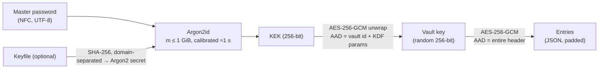

# SecureVault

**A password manager for Windows and Linux that keeps your logins on your own
computer. A desktop app and a command line; no cloud, no account, no telemetry.**

[](https://github.com/Shmadhs/secure_vault_project/actions/workflows/ci.yml)
[](https://github.com/Shmadhs/secure_vault_project/actions/workflows/codeql.yml)


[](LICENSE)

Save your logins (username, password, website, notes, tags and two-factor
codes), generate strong passwords, copy them with automatic clipboard
clearing, and find the ones that are reused or weak. Everything stays in one
encrypted vault on your disk, behind a single master password.

---

## Features

### Everyday use

| | |
|---|---|
| 🪟 **Desktop app** | `svault-gui`: the first run walks you through choosing a master password, then shows your logins with search, tags and a detail pane |
| ⌨️ **Command line** | `svault` for terminals and scripts, and `svault shell`: unlock once, auto-locks after inactivity |
| 🎲 **Password generator** | Random passwords (every character class guaranteed) and EFF-diceware passphrases (77.5 bits for 6 words), with an entropy readout |
| ⏱️ **Two-factor codes** | TOTP codes (RFC 6238) shown live with a countdown |
| 📋 **Careful clipboard** | Copied passwords are cleared automatically, never what *you* copied afterwards, and are kept out of Windows clipboard history and cloud sync |
| 🩺 **Password health** | Finds reused, weak and old passwords, locally |
| 🔒 **Auto-lock** | After inactivity, when the window is minimized, and on exit; on Windows the app is also hidden from screenshots and screen sharing |
| 🔄 **Migrate in and out** | Import CSV from Bitwarden, KeePassXC, Chrome/Edge and Firefox; export to CSV/JSON |
| 🌍 **Unicode-correct** | Greek and other accented master passwords work on every OS and keyboard layout |

### Under the hood

| | |
|---|---|
| 🔐 **Modern cryptography** | Argon2id (RFC 9106) calibrated per machine, up to 1 GiB of memory; AES-256-GCM; random 256-bit vault key |
| 🙈 **Everything encrypted** | Titles, usernames, URLs, notes and entry count are all inside one ciphertext, padded to hide exact size |
| 🛡️ **Tamper-evident** | Every byte authenticated. A modified file is reported as such, not as "wrong password" |
| 🔑 **Keyfile 2FA** | Optional keyfile fed into Argon2id's `secret` input |
| 💾 **Never lose data** | Crash-safe atomic saves, rotating encrypted backups, verified restore, conflict detection between processes |

## Install

Requires Python 3.10+.

**Desktop app** (includes the command line):

```bash
python -m pip install "securevault[gui] @ git+https://github.com/Shmadhs/secure_vault_project.git"
```

The desktop app is an optional extra, so the command-line core keeps its single
runtime dependency. It adds PySide6-Essentials (Qt widgets only, no WebEngine).

**Command line only:**

```bash
pipx install git+https://github.com/Shmadhs/secure_vault_project.git
```

Or download a standalone command-line binary (Windows `.exe` / Linux) from
[Releases](https://github.com/Shmadhs/secure_vault_project/releases), and check
it against `SHA256SUMS` and its GitHub build-provenance attestation:

```bash
gh attestation verify svault-linux-x64 --repo Shmadhs/secure_vault_project
```

**Linux clipboard:** install `wl-clipboard` (Wayland) or `xclip`/`xsel` (X11).
Without them, use `--print` in the command line.

## Using the desktop app

Start it with `svault-gui` (optionally `--vault PATH` and `--keyfile PATH`).

* **First run:** a welcome screen asks for one thing, your master password. It
  suggests a six-word passphrase to write down, or you choose your own. Where the
  vault is saved, an optional keyfile and the unlock time are under *Advanced*;
  the defaults suit almost everyone. Then the empty vault offers **Add your first
  password**.
* **After that:** the login screen is just the master password. The keyfile
  field appears only if your vault needs one. *Change…* opens a different vault;
  *Restore from a backup…* is there too, because a damaged vault cannot be
  unlocked to reach it.
* **Your logins:** a list with search (titles, usernames, URLs, tags, notes) and a
  tag filter. The detail pane shows the password masked (reveal on request),
  copy buttons, and the live two-factor code.
* **Add, edit and delete.** Deleting asks you to type the title exactly as
  shown. If a save fails, nothing half-saved is left behind; if the vault was
  changed elsewhere meanwhile (say `svault add` while the app was open), the app
  locks and asks you to unlock again rather than overwrite that change.
* **Tools:** password generator, password health, change master password (asks
  for the current one again), encrypted backups and verified restore.
* **Locking:** after 5 minutes without keyboard or mouse-click activity
  (configurable), when minimized (optional), on exit, or with Ctrl+L. Locking
  closes every open dialog, clears every view, and removes the last copied value
  from the clipboard if it is still there.
* **On Windows, its windows are hidden from screenshots and screen sharing**
  (`SetWindowDisplayAffinity`), so a password revealed during a Teams or Zoom
  call does not show up in it. This can be turned off in Preferences.

| Shortcut | Action | Shortcut | Action |
|---|---|---|---|
| Ctrl+C | copy password | Ctrl+N | add password |
| Ctrl+B | copy username | Ctrl+E / double-click | edit entry |
| Ctrl+U | copy URL | Del | delete entry |
| Ctrl+T | copy TOTP code | Ctrl+G | generator |
| Ctrl+F | search | Ctrl+L | lock |

## Using the command line

```text
$ svault add GitHub -u kostas --url https://github.com --generate
Master password (vault.svault):
Added 'GitHub' with a generated 156-bit password.

$ svault get github
Master password (vault.svault):
Copied the password of 'GitHub' to the clipboard; it will be cleared in 20 s.
```

```bash
svault init                       # create a vault; offers a generated passphrase
svault init --new-keyfile ~/vault.key   # ...and require a keyfile as well

svault add "Τράπεζα" -u kostas --passphrase   # add with a generated passphrase
svault add Email -u me@example.com            # prompts for the password (hidden)
svault add GitHub --totp -g                   # prompts for the TOTP secret

svault list [--tag work]          # list entries
svault search bank                # search titles, usernames, URLs, tags, notes
svault get github                 # copy password; auto-clears after 20 s
svault get github -f username     # copy another field
svault get github --print | xclip # print instead (for piping)
svault show github [--reveal]     # details, password masked unless --reveal
svault totp github [--copy]       # current one-time code
svault edit github --generate     # new password; the old one goes to history
svault rm "Old Account"           # exact title or id required

svault gen --length 32            # generate a password (no vault needed)
svault gen --words 6              # generate a passphrase
svault audit                      # reused / weak / stale passwords
svault passwd [--recalibrate]     # change master password (rotates the vault key)

svault import bitwarden.csv [--dry-run]
svault export backup.json         # PLAINTEXT, asks you to type 'export'
svault backups                    # list encrypted automatic backups
svault restore 1                  # verify a backup, then restore it
svault info                       # file and KDF details, no password needed
svault shell                      # interactive session with auto-lock
```

Default vault location: `%LOCALAPPDATA%\SecureVault\vault.svault` on Windows,
`~/.local/share/securevault/vault.svault` on Linux. Override with `--vault` or
`SVAULT_VAULT`.

**Exit codes:** `0` ok · `1` error · `2` usage · `3` wrong password/keyfile ·
`4` integrity failure (file modified, restore from backup).

**Git Bash on Windows:** mintty does not give Python a real console, so echo
cannot be disabled. SecureVault refuses to prompt there instead of showing your
password. Use Windows Terminal or PowerShell, or prefix the command with `winpty`.

## Security design

SecureVault v2 is a ground-up rewrite that followed a security audit of v1. The
audit found nine defects, from a hardcoded pepper to plaintext metadata (see
[the lessons table](docs/THREAT_MODEL.md#lessons-from-the-v1-audit)). Every
design choice below is documented with its reasoning in
[docs/DESIGN.md](docs/DESIGN.md).



```text
+------+---------+------------+--------------------------+-----------------------------------+
| SVLT | version | header_len | header (canonical JSON)  | payload                           |
|      |   u16   |    u32     | KDF params, wrapped key  | nonce | AES-256-GCM(entries) | tag|
+------+---------+------------+--------------------------+-----------------------------------+
|<------------ authenticated as the payload's AAD ------->|
```

* **What an attacker holding the file can do:** run Argon2id with the stored
  parameters, one guess at a time, at up to 1 GiB of memory per guess. That is
  all.
* **What they learn without the password:** the KDF parameters, whether a
  keyfile is required, and the payload size rounded up to 1 KiB.
* **Full spec:** [docs/FORMAT.md](docs/FORMAT.md) · **Threat model:**
  [docs/THREAT_MODEL.md](docs/THREAT_MODEL.md) · **Design decisions:**
  [docs/DESIGN.md](docs/DESIGN.md)

### What SecureVault does *not* protect against

Malware running as your user while the vault is unlocked, root/administrator
access to a running machine, or rollback to an older copy of your own vault.
No offline password manager can. Python also cannot guarantee that secrets are
wiped from memory. The [threat model](docs/THREAT_MODEL.md#residual-risks-stated-honestly)
lists every residual risk.

## Quality gates

Every push runs on Windows, Linux and macOS with Python 3.10–3.14:

* **320 tests**, including:
  * known-answer tests for Argon2id (RFC 9106 §5.3), TOTP (RFC 6238 Appendix B) and HOTP (RFC 4226);
  * a property test (Hypothesis) that flips random bits and checks the vault never opens;
  * truncation at every length, header splicing between vaults, rollback of the vault key after a password change;
  * crash-during-save and cross-process conflict cases;
  * 67 GUI tests (pytest-qt, headless): every flow above, lock purging, rollback,
    and hostile entries (HTML markup, bidi overrides, terminal escapes) that must
    be displayed literally.
* The core test job runs without Qt installed, and 4 more tests prove the GUI
  stays optional: the CLI never loads Qt, and `svault-gui` explains the missing extra.
* `ruff` (including the `bandit` rule set and Trojan-Source detection) and `mypy --strict` for all three platforms.
* `bandit`, `pip-audit` and CodeQL.
* Release binaries are built in CI, never committed, and ship with SHA-256 sums
  and [build provenance attestations](https://docs.github.com/actions/security-for-github-actions/using-artifact-attestations).

## Development

```bash
git clone https://github.com/Shmadhs/secure_vault_project.git
cd secure_vault_project
python -m venv .venv && . .venv/bin/activate      # Windows: .venv\Scripts\activate
pip install -e ".[dev]"            # core; add ",gui,gui-test" for the GUI and its tests

pytest                      # tests (~30 s core, ~70 s with the GUI tests)
ruff check src tests && ruff format --check src tests
mypy --platform linux && mypy --platform win32
bandit -c pyproject.toml -r src && pip-audit
```

```text
src/securevault/
├── crypto.py        Argon2id, AES-GCM, KDF policy, calibration (the only module touching primitives)
├── vault_format.py  binary layout, strict header/payload parsing
├── vault.py         unlock / save / re-key / restore
├── storage.py       atomic writes, backups
├── model.py         entries, search, password history
├── clipboard.py     Win32 (ctypes) and wl-clipboard/xclip/xsel backends, auto-clear helper
├── generator.py     passwords, EFF passphrases, strength estimate
├── totp.py          RFC 6238 / 4226
├── audit.py         reused / weak / stale detection
├── transfer.py      CSV import (Bitwarden, KeePassXC, browsers), CSV/JSON export
├── osutil.py        paths, permissions, process hardening
├── cli.py           commands and the interactive shell
└── gui/             optional PySide6 desktop GUI over the same core (svault-gui)
```

## Roadmap

- [x] Desktop GUI (PySide6), with the same core
- [ ] GUI: lock when the OS session locks or the machine sleeps
- [ ] GUI: CSV import / export
- [ ] Standalone GUI binary in the release workflow
- [ ] Recovery-key slot (printable, high-entropy, fast KDF)
- [ ] YubiKey HMAC-SHA1 challenge-response as a key slot
- [ ] Offline breach check against a downloaded Have I Been Pwned hash list
- [ ] KeePass (KDBX 4) import
- [ ] Attachments and SSH keys

## Security

Please report vulnerabilities privately; see [SECURITY.md](SECURITY.md).

## License and credits

MIT, see [LICENSE](LICENSE). The passphrase wordlist is the
[EFF Large Wordlist](https://www.eff.org/dice) by the Electronic Frontier
Foundation, used under [CC BY 3.0 US](https://creativecommons.org/licenses/by/3.0/us/).
